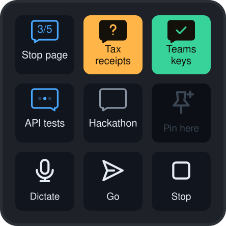

# Claude Keys

**Six agents, nine keys, (almost) no mouse.**

I've moved fully to dictation: most of my agent work is done by voice now. Typing went away, but the mouse didn't.
My day became one loop: find the session that needs me, click into it, dictate, send, find the next one.
So I wondered whether I could drop the mouse altogether, and put that loop on nine keys.

1. A key turns **amber**: that session is waiting for you.
2. **Tap it.** Claude jumps straight to it.
3. **Tap Dictate** and talk.
4. **Tap Return.** It sends, and the key turns blue while Claude works.
5. Glance down for the next amber key. Hold Return instead to send your words to a new session, a side chat or a fork.

Claude Keys is a plugin for the Logitech MX Creative Keypad and the Claude desktop app on macOS.
Codex threads can go on the session keys too, for the times you use both.

## Keys

| Key | Tap | Hold |
|---|---|---|
| Session 1–6 | Open that session (Claude or Codex). Empty: pin the session on screen | Pin here, Unpin, Archive (Claude only) |
| Dictate | Start or stop Claude's mic | — |
| Return | Press Return: sends, finishes dictation, or queues while Claude works | New (session), Side chat, Fork, Yes, Commit |
| Cancel | Press Escape: cancels dictation or interrupts Claude | Archive |

Session key colours: blue dots = working, amber = waiting for you, green = finished, grey = idle.
Codex bubbles point right.

## Hold pages

Holding Return, Cancel or a session key turns the keypad into a page of buttons. The Cancel key closes it,
and it closes by itself after 10 seconds.

- **Return** acts on the session on screen. New, Side chat and Fork take what you've typed or dictated and send it to a
  new session, a side chat (`/btw`) or a fork of this one. Yes presses the main button of Claude's next-step box,
  or sends your text when there's no box. Commit sends "Let's do a commit".
- **Cancel** archives the session on screen.
- **A session key**: Pin here puts the session on screen on that key, Unpin empties the key, and Archive
  archives that key's session.

## Install

You need a Mac, the Claude desktop app, Logi Options+ and an MX Creative Keypad.
Clone this repo somewhere it can stay: the plugin runs from this folder.

**Option A: ask Claude.** Open this folder in Claude Code and say "install this for me". It reads `AGENTS.md`,
sets up the tools, builds the plugin and tells you which keys to place. Ask it for changes the same way.

**Option B: by hand.**

1. `brew install --cask dotnet-sdk`
2. `dotnet tool install --global LogiPluginTool`
3. `cd ClaudeKeysPlugin && dotnet build`
4. In Logi Options+, drag the Claude Keys actions onto your keypad: Session 1–6, Dictate, Return and Cancel.
   Put them wherever you like; the picture above is one layout.

## Tip: short session names

Session names are long by default. Add this to `~/.claude/CLAUDE.md` so they fit on a key:

    ## Session names
    - Rename the session with the session title tool at the start of a new session, and again right after a fork.
    - 1–3 words, under 16 characters, naming the task: "Login bug", "Tax receipts".
    - A fork gets a name for what it will do next, never "fork", "copy", "v2" or a number.
    - No filler words, dates or emoji.

## Limits

- Codex support covers the session keys only: they show a thread's status and switch to it.
  Dictate, Return and Cancel act on Claude only, and Archive on a held session key is Claude only.
- No ready-made layout. Logi plugins can ship a preset profile only for a specific app, and Claude Keys
  works in every app, so you place the keys yourself.
- Mac only. It reads Claude's and Codex's own files and shortcuts, which are undocumented,
  so an app update can break a key.
