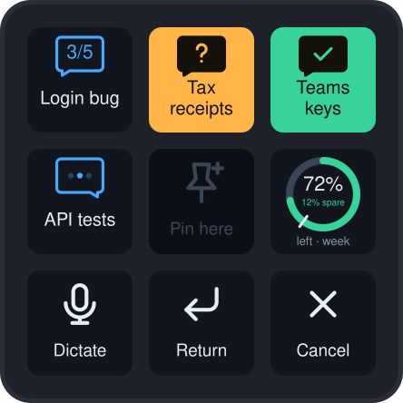

# Claude Keys

**Manage your Claude sessions from a Logitech MX Creative Keypad, without reaching for the mouse or keyboard.**

Six agents, nine keys: see who needs you, jump there, dictate, send.

I've moved fully to dictation: most of my agent work is done by voice now. Typing went away, but the mouse didn't.
My day became one loop: find the session that needs me, click into it, dictate, send, find the next one.
So I wondered whether I could drop the mouse altogether, and put that loop on nine keys.

1. A key turns **amber**: that session is waiting for you.
2. **Tap it.** Claude jumps straight to it.
3. **Tap Dictate** and talk.
4. **Tap Return.** It sends, and the key's bubble turns blue while Claude works.
5. Glance down for the next amber key. Hold Return instead to send your words to a new session, a side chat or a fork.

It works with the Claude desktop app on macOS. Codex threads can go on the session keys too, and Dictate,
Return and Cancel work in any app.

## Keys

| Key | Tap | Hold |
|---|---|---|
| Session 1–6 | Open that session (Claude or Codex). Empty: pin the session on screen | Pin here, Unpin |
| Dictate | Start or stop dictation in the app in front: Claude's mic in Claude, ChatGPT's dictation anywhere else | — |
| Return | Press Return in the app in front: sends, or finishes dictation | New (session), Side chat, Fork, Yes, Commit |
| Cancel | Press Escape in the app in front: cancels dictation or interrupts | Archive |

Session key colours: blue dots = working, amber = waiting for you, green = finished, grey = idle.
Codex bubbles point right.

## Hold pages

Holding Return, Cancel or a session key turns the keypad into a page of buttons. The Cancel key closes it,
and it closes by itself after 10 seconds.

- **Return** acts on the session on screen. New, Side chat and Fork take what you've typed or dictated and send it to a
  new session, a side chat (`/btw`) or a fork of this one. Yes presses the main button of Claude's next-step box,
  or sends your text when there's no box. Commit sends "Let's do a commit".
- **Cancel** archives the session on screen.
- **A session key**: Pin here puts the session on screen on that key, and Unpin empties the key.
  To archive a key's session, tap the key to open it, then hold Cancel.

## Install

You need a Mac, the Claude desktop app, Logi Options+ (signed in to a Logi account) and an MX Creative Keypad.

### 1. Get the plugin

**Option A: download it.** Download the `.lplug4` file from the [latest release](https://github.com/vicsz/claude-keys/releases/latest)
and double-click it. Logi Options+ installs it.

To build it yourself instead, clone this repo somewhere it can stay: a built plugin runs from this folder.

**Option B: ask Claude.** Open this folder in Claude Code and say "install this for me". It reads `AGENTS.md`,
sets up the tools and builds the plugin. Ask it for changes the same way.

**Option C: by hand.**

1. `brew install --cask dotnet-sdk`
2. `dotnet tool install --global LogiPluginTool`
3. `cd ClaudeKeysPlugin && dotnet build`

### 2. Place the keys

Logi plugins can't ship a ready-made layout (see [Logitech limitations](#logitech-limitations)), so you drag each key on once:

1. Open Logi Options+ and select your keypad.
2. Add a new page, or use the first one. Either works.
3. Open **All actions** and select **Claude Keys**.
4. Drag **Session 1–6**, **Dictate**, **Return** and **Cancel** onto the keys, wherever you like.
   The picture above is one layout.

### 3. Set the dictation shortcuts

Dictate presses one shortcut in Claude and another everywhere else:

| App | Setting | Set it to |
|---|---|---|
| Claude | Dictation shortcut | `Cmd+D` (the default) |
| ChatGPT (Codex) | Dictation → **Single-tap shortcut** | `Ctrl+Opt+Cmd+D` |

The ChatGPT one works in any app, so Dictate can type into Codex, Messages, Slack or anywhere else.
Skip it if you only use Claude.

## Tip: short session names

Session names are long by default. Add this to `~/.claude/CLAUDE.md` so they fit on a key:

    ## Session names
    - Rename the session with the session title tool at the start of a new session, and again right after a fork.
    - 1–3 words, under 16 characters, naming the task: "Login bug", "Tax receipts".
    - A fork gets a name for what it will do next, never "fork", "copy", "v2" or a number.
    - No filler words, dates or emoji.

## Limits

- **It reads Claude's and Codex's own files and shortcuts, which are undocumented, so an app update can break a key.**
- Session keys work with Claude Code sessions and Codex threads, not regular chats. Neither app saves which Claude
  or ChatGPT chat is open, or whether it's working, anywhere the plugin can read.
- Cursor isn't supported. Its chats and their status could be read, but no link opens a specific local chat,
  so a key could show a Cursor chat but not take you there.
- Mac only, for now. A Windows version should be a small change, likely one Claude can make in one go:
  the Mac-specific parts are mostly in `ClaudeApp.cs`, `ClaudeSessionStore.cs` and `CodexThreads.cs`.
  I just haven't tested it on Windows.
- Codex support covers the session keys, Return and Cancel. The hold pages and Archive are Claude only.
- The dictation shortcuts are fixed (`Cmd+D` in Claude, `Ctrl+Opt+Cmd+D` elsewhere). Choosing them in
  Logi Options+ is possible, but not built yet.

## Why not hooks?

Claude Code, Codex and Cursor all support hooks: scripts that run when an agent starts, stops or needs you.
Hooks are documented, so they'd break less often than reading the apps' own files does.

Claude Keys skips them because they need setting up on every machine, and for every app. As it is, it works as
soon as it's installed, with nothing to configure. The trade-off is the bold point under Limits: an app update
can break a key.

Hooks could still add to it later, as a steadier status source for anyone willing to set them up, or as the
way to support an app like Cursor, whose files don't say enough.

## Logitech limitations

Three things work the way they do because of how Logi's plugin system works:

- **Six separate session keys, not one.** When a key is pressed or drawn, the plugin is only told which action
  it is, not which key on the keypad. Six copies of one "Session" action would look identical: they'd all show
  the same session, and a press couldn't tell them apart. So each key is its own action, Session 1 to 6,
  and each one tracks its own session.
- **No ready-made layout.** Logi plugins can ship a preset profile only for a specific app. Claude Keys works
  in every app, so it can't install a layout for you, and you drag the keys on yourself.
- **You need a Logi account.** Logi Options+ only lets you add plugins while you're signed in, so create a free
  account first. It's an odd requirement for a local plugin, but there's no way around it.

## Stream Deck

Elgato's Stream Deck could do this too, and in many ways it's more powerful. It comes with more keys
(up to 32), and its plugin system avoids two of the limits above: each key knows which one it is, and
plugins can ship a layout.

The Logitech advantage: Logi Options+ is often already approved on work laptops, and Stream Deck's software
often isn't.
